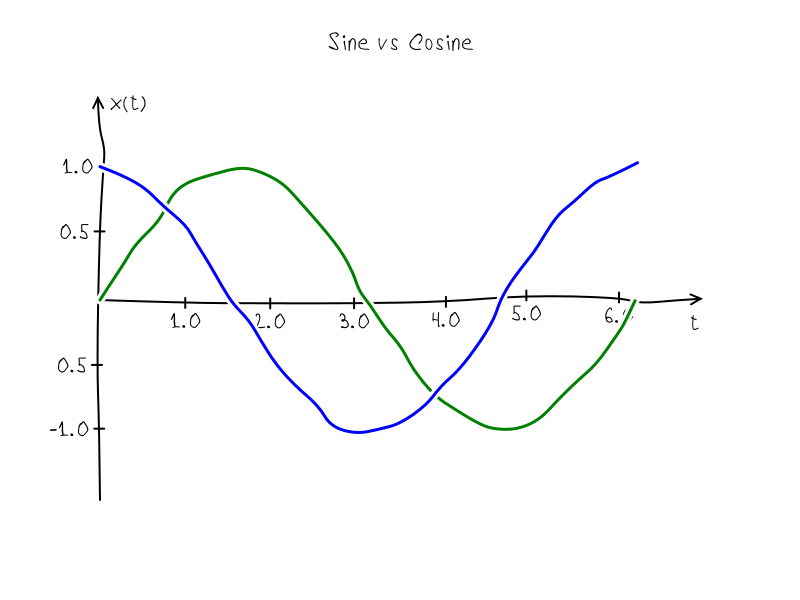
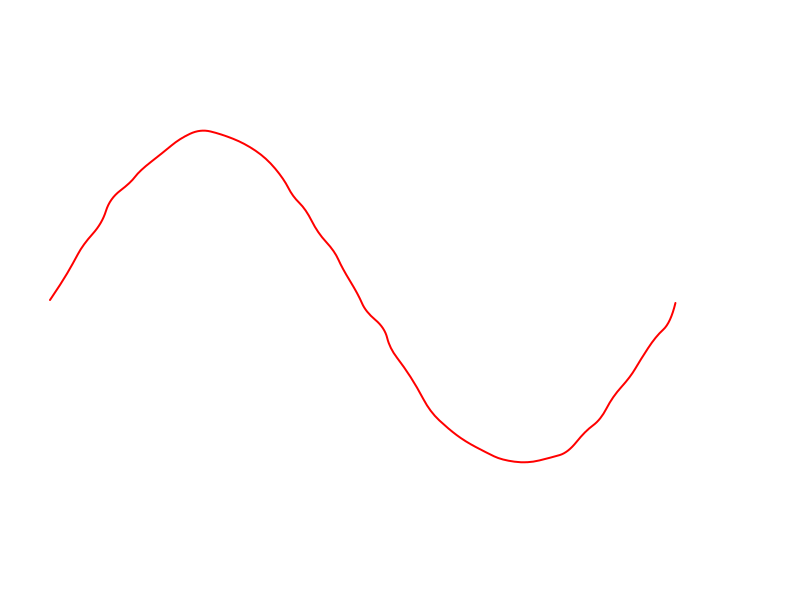
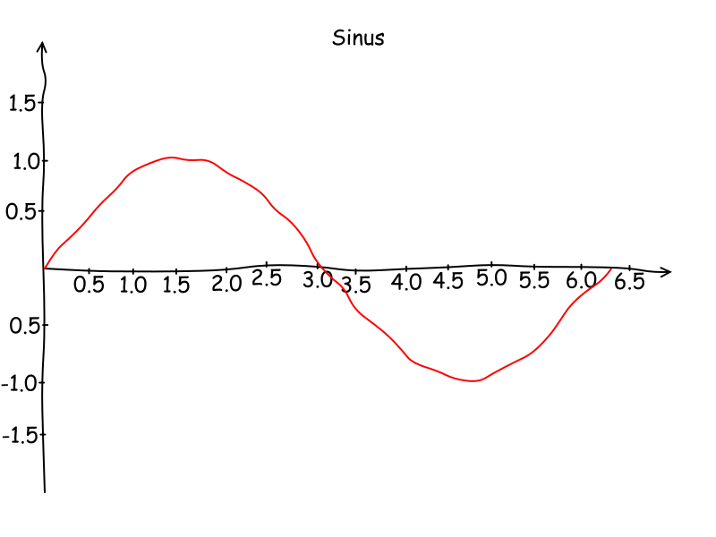
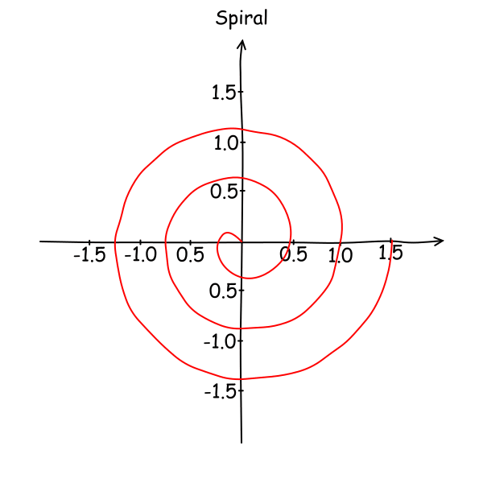

# Clumsy

  [![NPM Version][npm-image]][npm-url]
  [![NPM Downloads][downloads-image]][downloads-url]
  [![CI][ci-image]][ci-url]


Draw math figures on a canvas in an XKCD style. The same drawing script runs in a browser and in Node.js.

```shell
npm install clumsy
```

Rendering to PNG or GIF in Node.js also needs [`canvas`](https://www.npmjs.com/package/canvas) and [`gifencoder`](https://www.npmjs.com/package/gifencoder):

```shell
npm install canvas gifencoder
```



## Contents

  * [Preparing for drawing](#preparing)
  * [Drawing a figure](#drawing)
  * [Drawing a figure with scaled axis and title](#axis-and-title)
  * [Animation](#animation)
  * [API](#api)
    * [new Clumsy(canvas)](#newclumsy)
    * methods:
    * [axis](#axis)
    * [background](#background)
    * [clean](#clean)
    * [draw](#draw)
    * [fillTextAtCenter](#filltext)
    * [overdraw](#overdraw)
    * [padding](#padding)
    * [seed](#seed)
    * [range](#range)
    * [tabulate](#tabulate)
    * properties:
    * [background](#properties)
    * [color](#properties)
    * [defaultBoxAscent](#properties)
    * [lineWidth](#properties)
    * [radius](#properties)
    * [step](#properties)

  * [License](#license)

<a name="preparing"></a>
## Preparing for drawing

 Create a canvas and pass it to the Clumsy constructor. Padding starts at 0. The default range maps the canvas itself: x runs from 0 to the canvas width and y runs from 0 to the canvas height, with the origin at the bottom left. Set padding and range before drawing.

```js
// Optional Node.js canvas. In a browser, use a <canvas> element instead.
var createCanvas = require('canvas').createCanvas;

var Clumsy = require('clumsy');
var helpers = require('clumsy/helpers');

var canvas = createCanvas(800, 600);
var clumsy = new Clumsy(canvas);

// Sets padding and ranges before drawing
clumsy.padding(50);
clumsy.range(0, 2*Math.PI, -1.5, 1.5);
```

<a name="drawing"></a>
## Drawing a figure

Pass arrays with points to method draw. Each point must consider x and y field, e.g. {x: 0, y: 0} - begin coordinate system.

```js
var createCanvas = require('canvas').createCanvas;
var Clumsy = require('clumsy');
var helpers = require('clumsy/helpers');

var canvas = createCanvas(800, 600);
var clumsy = new Clumsy(canvas);

clumsy.padding(50);
clumsy.range(0, 2*Math.PI, -1.5, 1.5);
clumsy.clean('white');
clumsy.color('red');
clumsy.lineWidth(2);

var sine = clumsy.tabulate(0, 2*Math.PI, 0.01, Math.sin);
clumsy.draw(sine);

helpers.saveAsPng(clumsy); // save as png of same name
```

The result:




<a name="axis-and-title"></a>
## Drawing a figure with scaled axis and title

```javascript
var createCanvas = require('canvas').createCanvas;
var Clumsy = require('clumsy');
var helpers = require('clumsy/helpers');

var canvas = createCanvas(800, 600);
var clumsy = new Clumsy(canvas);

clumsy.font('24px VoronovFont');
clumsy.padding(50);
clumsy.range(0, 7, -2, 2);
clumsy.clean('white');
clumsy.lineWidth(2);

clumsy.axis('x', 0, 7, 0.5);
clumsy.axis('y', -2, 2, 0.5);

clumsy.color('red');
var sine = clumsy.tabulate(0, 2*Math.PI, 0.01, Math.sin);
clumsy.draw(sine);

clumsy.fillTextAtCenter('Sinus', clumsy.canvas.width/2, 50);

helpers.saveAsPng(clumsy);

```

The result:




<a name="animation"></a>
## Animation

This module also can be used for animation of figure. The best way is prepare a separate script with drawing function.
The function must receive two arguments: a clumsy object and an animation param. So without any other dependencies this script can be used for rendering by both ways in a browser or  node.js

Drawing script [spiral.js](examples/spiral.js):

```js

function Spiral(clumsy, phase){
    clumsy.font('24px VoronovFont');
    clumsy.clean('white');

    clumsy.padding(50);
    clumsy.range(-2, 2, -2, 2);
    clumsy.lineWidth(2);
    clumsy.radius(5);

    clumsy.color('black');
    clumsy.axis('x', -2, 2, 0.5);
    clumsy.axis('y', -2, 2, 0.5);

    var spiral = clumsy.tabulate(0, 3, 0.01, function(t){
        var r = 0.5 * t;
        return {
            x: r * Math.cos(2 * Math.PI * t + phase),
            y: r * Math.sin(2 * Math.PI * t + phase)
        };
    })

    clumsy.color('red');
    clumsy.draw(spiral);

    clumsy.fillTextAtCenter('Spiral', clumsy.canvas.width/2, 30);
}

if(typeof module != 'undefined' && module.exports){
    module.exports = Spiral;
}

```

Preview script for browser:

```html
<!DOCTYPE html>
<meta charset="utf-8">
<title>spiral</title>
<script src="https://cdn.jsdelivr.net/gh/kreshikhin/clumsy@master/clumsy.js"></script>
<link rel="stylesheet" href="http://webfonts.ru/import/voronov.css"></link>
<canvas id="canvas" width=600 height=600>
<script type="text/javascript" src="spiral.js"></script>
<script type="text/javascript">
    var canvas = document.getElementById('canvas');
    var clumsy = new Clumsy(canvas);
    clumsy.font('12px VoronovFont');

    var phase = 0;
    setInterval(function(){
        clumsy.seed(123);

        clumsy.clean('white');
        Spiral(clumsy, phase);

        phase += Math.PI / 10;
    }, 50);
</script>
```

Building script for node.js:

```js

var createCanvas = require('canvas').createCanvas;
var GIFEncoder = require('gifencoder');
var path = require('path');
var fs = require('fs');

var Clumsy = require('clumsy');
var helpers = require('clumsy/helpers');

var Spiral = require('./spiral.js');

var canvas = createCanvas(600, 600);
var clumsy = new Clumsy(canvas);
clumsy.font('24px VoronovFont');

var encoder = helpers.prepareEncoder(GIFEncoder, canvas);
var phase = 0;
var n = 10;

encoder.start();
for(var i = 0; i < n; i++){
    clumsy.seed(123);

    clumsy.clean('white');
    Spiral(clumsy, phase);

    phase += 2 * Math.PI / n;
    encoder.addFrame(clumsy.ctx);
};

encoder.finish();
```

The result:




## API

<a name="newclumsy"></a>
### new Clumsy(canvas)

Creates new clumsy object.

* `canvas` - an instance of HTMLCanvas

```js
var clumsy = new Clumsy(canvas);
```

<a name="axis"></a>
### axis(axis, start, end, [step | options]);
Draws axis.

* `axis` may be 'x', 'y', {x: 1, y: 1}
* `start`, `end` - range of axis
* `step` - step of scale
* `options` - sets of options allowed by method:
  * `zero` - coordinates of zero point of the axis
  * `step` - a step of the scale
  * `limits` - limits of scale, [start + step, end - step] by default
  * `hide_zero` - hides zero if true
  * `tick_size` - size of scale ticks in px, default is 5px
  * `mark` - a function that generate label for ticks

```js
// Draws axis from -1 to 1 without a scale
clumsy.axis('x', -1, 1);
// Draws axis from -1 to 1 with a scale and step 0.2
clumsy.axis('x', -1, 1, 0.2);
// Draws axis with custom options:
clumsy.axis('x', -1, 1, {
    zero: {x: 0, y: 0}, // default
    step: 0.1,
    limits: [start + step, end - step],
    hide_zero: true, // hide zero mark
    tick_size: 5, // in px
    mark: function(t){ // default
        return parseInt(t) + '.' + parseInt(Math.abs(t*10) % 10)
    }
});
```

<a name="clean"></a>
### clean([color])
Updates the background color (if argument is not undefined) and cleans the canvas.

 * `color` - new background color.

```js
clumsy.clean();
```

`clear(color)` is an alias of `clean(color)`.

<a name="draw"></a>
### draw(curve)

Draws a curve by array of point in `{x: x, y: y}` format.

* `curve` is [{x: x0, y: y0}, ... {x: xn-1, yn-1}]

```js
// Draws line from (0,0) to (1,1).
clumsy.draw([{x: 0, y:0}, {x: 1, y:1}]);
```

<a name="fillText"></a>
### fillTextAtCenter(text, x, y)

Draws text centered horizontally around x. y is the text baseline.

* text - a text for drawing
* x, y - horizontal center and baseline

```js
clumsy.fillTextAtCenter("Hello World!", 100, 100);
```
<a name="overdraw"></a>
### overdraw(curve)

Draws a curve with clearing canvas under the curve by background color.

* `curve` is [{x: x0, y: y0}, ... {x: xn-1, yn-1}]

```js
// Draws a line from (0, 0) to (1, 1).
clumsy.draw([{x: 0, y: 0}, {x: 1, y: 1}]);
// Overdraws a line from (1, 0) to (0, 1).
clumsy.overdraw([{x: 1, y: 0}, {x: 0, y: 1}]);
```

<a name="padding"></a>
### padding(size)
### padding(horizontal, vertical)
### padding(left, right, bottom, top)

Sets paddings from the edges of the canvas.

* `size` - size of all paddings
* `horizontal`, `vertical` - left/right and bottom/top paddings
* `left`, `right`, `bottom`, `top` - padding of each edge

```js
// Sets every padding to 100px
clumsy.padding(100);
// Sets horizontal padding to 100px and vertical padding to 200px
clumsy.padding(100, 200);
// Sets left, right, bottom and top paddings
clumsy.padding(50, 100, 150, 200);
```

<a name="range"></a>
### range(start, end)
### range(start0, end0, start1, end1)

Sets ranges of the coordinate system.

```js
// Sets same range for horizontal and vertical scales
clumsy.range(-10, 10);
// Sets horizontal [-10,10] and vertical [-20,20] ranges
clumsy.range(-10, 10, -20, 20);
```

<a name="seed"></a>
### seed([seed])
Sets the seed of generator of pseudo random numbers.

```js
// Sets the seed
clumsy.seed(123456);
// Gets current seed
var seed = clumsy.seed();
```

### properties

Properties with setters/getters:

```js
// In pixels
clumsy.step(10);
clumsy.radius(10);
clumsy.defaultBoxAscent(16);
clumsy.lineWidth(1);

// CSS color
clumsy.background('white');
clumsy.color('black');

// CSS font
clumsy.font('12px Arial');

// Seed number for the built-in pseudo random generator
clumsy.seed(12345);
```

## Development

The package has no runtime dependencies. `canvas` and `gifencoder` are optional and are only needed for the Node.js examples.

```shell
npm test
```

GitHub Actions runs the tests on Node.js 22, 24, and 26.

## Changes in 1.2.0

- Removed the unused `lodash` dependency. Installs no longer pull in a wildcard dependency tree.
- Replaced Mocha with the built-in Node.js test runner.
- Replaced Travis CI with GitHub Actions.
- `clear` is an alias of `clean`.
- Drawing no longer changes the points you pass in, so `overdraw` traces the same curve twice.
- `axis('-y')` points along negative Y. Tick size is preserved when a curve is scaled.
- Node.js examples use `createCanvas` and `createPNGStream` from current `canvas`.

## License

  [MIT](LICENSE)

[npm-image]: https://img.shields.io/npm/v/clumsy.svg
[npm-url]: https://npmjs.org/package/clumsy
[downloads-image]: https://img.shields.io/npm/dm/clumsy.svg
[downloads-url]: https://npmjs.org/package/clumsy
[ci-image]: https://github.com/kreshikhin/clumsy/actions/workflows/ci.yml/badge.svg
[ci-url]: https://github.com/kreshikhin/clumsy/actions/workflows/ci.yml
